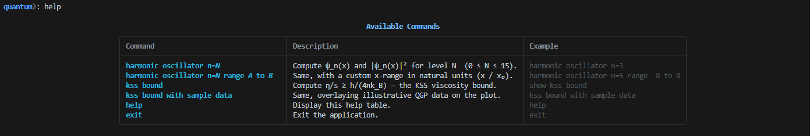
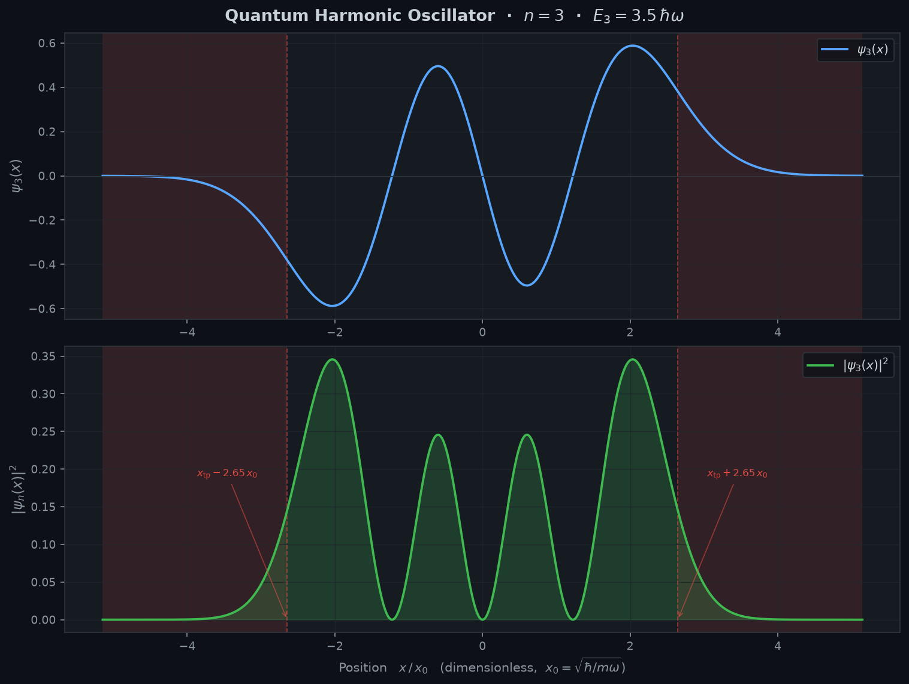
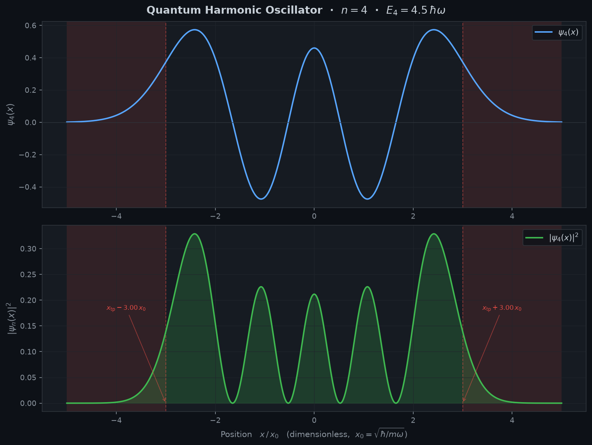
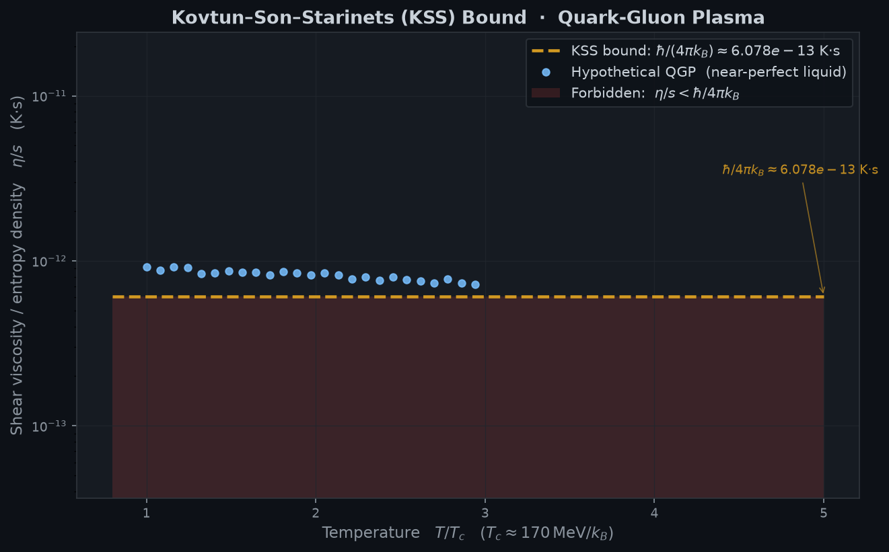

<div align="center">

<p align="center">
  
</p>

# ⚛️ Quantum-CLI

**A Terminal-First, AI-Integrated Computational Physics Engine**

[](https://www.python.org/)
[](LICENSE)
[]()
[](https://github.com/Textualize/rich)
[](https://scipy.org/)
[](https://www.sympy.org/)

> *"Where the terminal meets the quantum."*
>
> A developer and research environment for simulating quantum mechanics and non-perturbative QCD — entirely inside your terminal. Features natural-language command parsing, publication-grade dark-theme plots, and standalone LaTeX export.

</div>

---

## 🚀 Quick Start

### 1. Run Directly with `uv` (No Manual Setup Needed)
If you have [`uv`](https://github.com/astral-sh/uv) or [`pipx`](https://pypa.github.io/pipx/) installed, you can launch or install Quantum-CLI globally in one line:

```bash
uv tool install git+https://github.com/Dharmendra-05/Quantum-CLI.git
```
Then anywhere in your terminal:
```bash
quantum
```

### 2. Local Developer Installation
```bash
# Clone the repository
git clone https://github.com/Dharmendra-05/Quantum-CLI.git
cd Quantum-CLI

# Run immediately using uv
uv run quantum

# Or install in editable mode
uv sync --extra dev
uv run quantum
```

---

## 🕹️ Interactive CLI & Commands

Quantum-CLI features a rule-based AI parser that interprets both structured flags and natural English instructions:

<p align="center">
  
</p>

| Command | Description | Example |
|---|---|---|
| `harmonic oscillator n=N` | Computes $\psi_n(x)$ and $\|\psi_n(x)\|^2$ for level $N$ ($0 \le N \le 15$). | `harmonic oscillator n=3` |
| `qho n=N range A to B` | Computes wavefunction over a custom domain in natural units ($x/x_0$). | `harmonic oscillator n=5 range -8 to 8` |
| `kss bound` | Calculates the universal lower viscosity bound $\eta/s \ge \hbar/(4\pi k_B)$. | `show kss bound` |
| `kss bound with sample data` | Overlays illustrative Quark-Gluon Plasma (QGP) data on the plot. | `kss bound with sample data` |
| `help` | Displays the interactive commands and syntax guide. | `help` |
| `exit` | Exits the interactive REPL session. | `exit` |

---

## 📊 Visual Results Gallery

All calculations automatically produce publication-ready, dark-themed Matplotlib figures saved to `./quantum-exports/`:

### 1. 1D Quantum Harmonic Oscillator ($n=3$ & $n=4$)
Calculates exact normalized eigenstates using physicists' Hermite polynomials $H_n(\xi)$ in natural units ($\hbar = m = \omega = 1$), eliminating catastrophic numerical underflow.

$$E_n = \left(n + \frac{1}{2}\right)\hbar\omega$$

Classical turning points $x_{\text{tp}} = \sqrt{2n+1}$ are marked with dashed boundaries, and classically forbidden quantum tunneling regions are dynamically shaded.

<p align="center">
  
</p>

<p align="center">
  
</p>

---

### 2. Quantum Chromodynamics (QCD) — The KSS Viscosity Bound
Evaluates transport coefficients in strongly coupled Quark-Gluon Plasmas (QGP). Evaluates the universal Kovtun–Son–Starinets (KSS) lower bound derived via gauge/gravity duality:

$$\frac{\eta}{s} \ge \frac{\hbar}{4\pi k_B} \approx 6.0794 \times 10^{-13}\,\text{K}\cdot\text{s}$$

<p align="center">
  
</p>

---

## 🏗️ Architecture

Quantum-CLI enforces clean layer separation and lazy module loading:

```
Quantum-CLI/
├── pyproject.toml              # Packaging metadata, hatchling build & console script
├── pytest.ini                  # Pytest configuration with pythonpath = src
├── main.py                     # Backward-compatible CLI runner
├── src/
│   └── quantum_cli/
│       ├── __init__.py         # Package version (0.1.0)
│       ├── __main__.py         # python -m quantum_cli entry
│       ├── cli/                # Terminal layer: Rich UI, banner, tables & spinners
│       │   ├── main.py         # Entry runner function
│       │   └── ui.py           # QuantumCLI REPL loop
│       └── core/               # Pure physics & models
│           ├── physics_engine.py  # QHO & QCD numerical engines
│           ├── ai_agent.py        # Rule-based natural language intent parser
│           └── latex_generator.py # Standalone .tex report generator
├── tests/
│   └── golden/                 # Characterization tests locking numerical accuracy
├── benchmarks/
│   └── baseline.md             # Startup wall-clock time & memory profiles
├── assets/                     # Screenshots and UI media
└── quantum-exports/            # Generated plots and LaTeX exports
```

---

## 🧪 Testing & Verification

Quantum-CLI maintains a golden characterization test suite to guarantee numerical integrity across refactoring:

```bash
uv run --extra dev pytest tests/
```

Output:
```text
======================== 3 passed, 1 xfailed in 0.88s =========================
```

---

## 🤝 Contributing

We welcome contributions! Please see our [Contributing Guidelines](CONTRIBUTING.md) and [Code of Conduct](CODE_OF_CONDUCT.md).

---

## 📄 License

This project is licensed under the **MIT License** — see the [LICENSE](LICENSE) file for details.
